# OpsLens AI

[](https://github.com/HUSNAIN-MUNAWAR/opslens-ai/actions/workflows/ci.yml)
[](LICENSE)
[](apps/api/pyproject.toml)
[](https://fastapi.tiangolo.com/)
[](https://nextjs.org/)
[](docker-compose.yml)

OpsLens AI is a governed decision-intelligence platform for retail, ecommerce, inventory, supplier, finance, ERP, and operations teams. It turns fragmented synthetic demo data into traceable insights, quality-aware analytics, alerts, forecasts, scenarios, investigations, approval-controlled recommendations, executive reports, and audit evidence.

> **Synthetic workspace notice:** this repository is a production-oriented reference implementation. It does not claim real customers, real business impact, certifications, live ERP synchronization, or live external delivery.

## Why OpsLens AI exists

Operations teams need more than a chatbot. They need a system that can answer business questions while proving what data was used, what SQL was generated, which governance rules passed, which data-quality warnings apply, and whether humans approved the next action.

OpsLens AI demonstrates that lifecycle end to end:

```text
Data Source → Import / Sync → Validation → Data Quality Assessment → Metric Calculation → AI Question / Query Plan → SQL AST Validation → Read-Only Execution → Evidence Package → Alert / Forecast / Anomaly → Investigation → Scenario Simulation → Approval → Report → Audit Trail → Optional Integration Boundary
```

## Key capabilities

| Area | Phase 3 capability |
|---|---|
| API-driven UX | Core demo surfaces include live FastAPI reads/mutations via a typed client and operational feedback panel. |
| Governed AI | Deterministic Copilot creates query plans, SQL validation records, evidence packages, quality warnings, and audit events. |
| SQL safety | SQLGlot-backed AST validation when available, conservative fallback parser in restricted local environments, tenant predicate checks, table allowlists, row limits, complexity budgets, and blocked DDL/DML. |
| Multi-tenancy | Three synthetic organizations with membership checks, workspace switching, backend tenant scoping, and Branch Manager branch restrictions. |
| Data quality | Data trust, freshness, source status, quality issues, and warnings propagated into Copilot, dashboards, reports, forecasts, and scenarios. |
| Workflows | Alerts → investigations → scenarios → approvals → reports → audit trail. |
| Ingestion | CSV upload plus JSON import, preview, column mapping, validation, dry-run style preview, simulated commit, rollback simulation, import history, and lineage events. |
| Reporting | Executive report records, PDF/CSV export, schedules, run-now action, simulated delivery, and export audits. |
| Security | Strong password hashing, signed tokens, scoped expiring API keys, revocation, request IDs, rate limiting, production startup validation, and security center. |
| Developer platform | `/api/v1` routes, OpenAPI docs, API-key endpoint, webhook documentation, SDK-style Python client, and examples. |

## Screenshots

| Surface | Screenshot |
|---|---|
| Landing page | 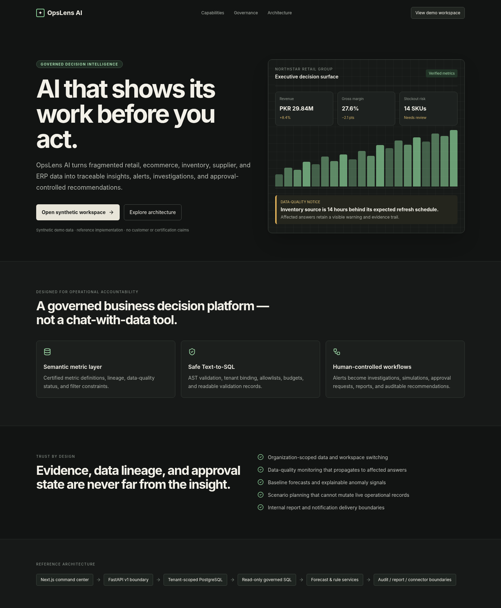 |
| Executive dashboard | 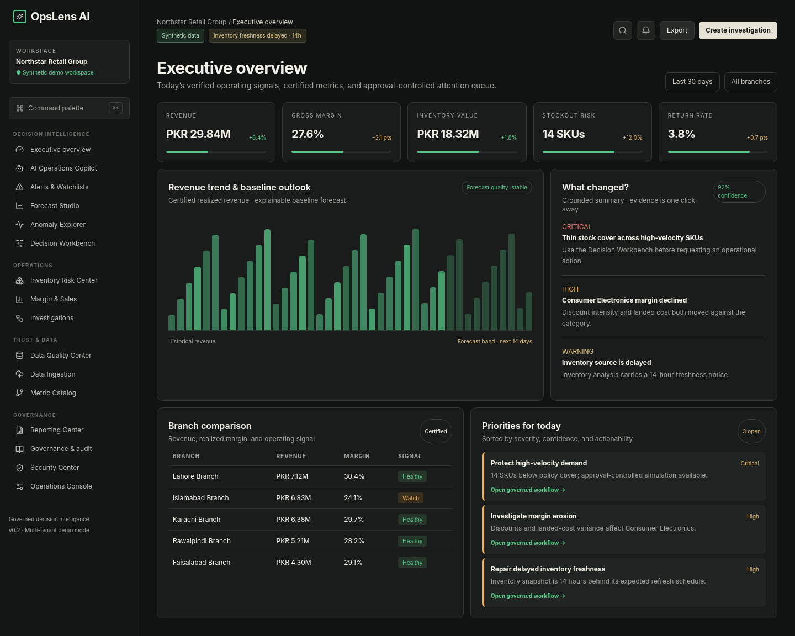 |
| Copilot evidence | 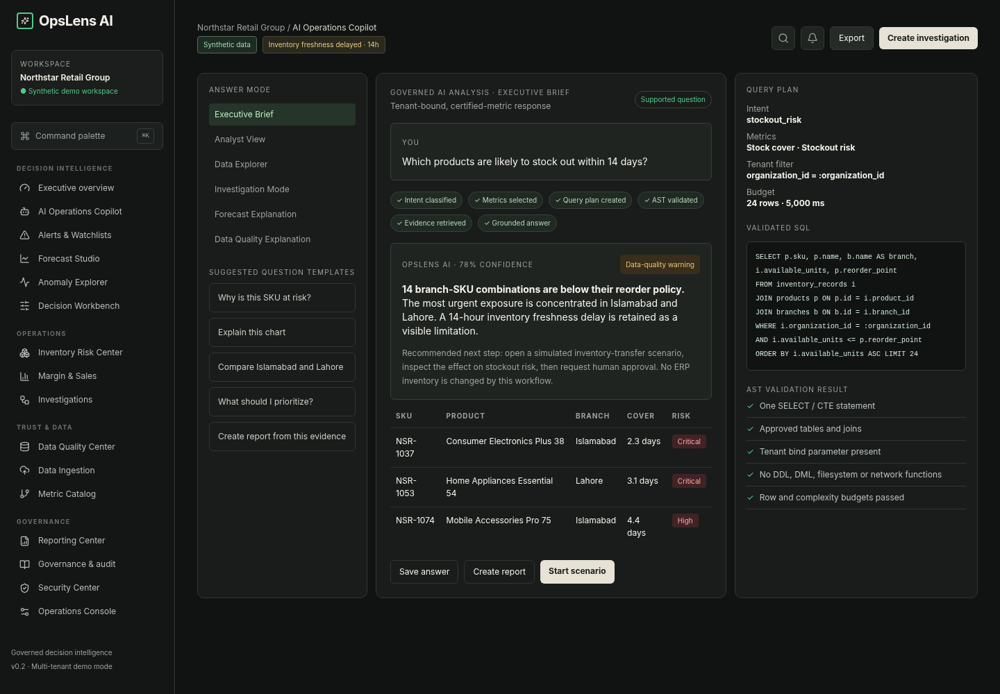 |
| Data Quality Center | 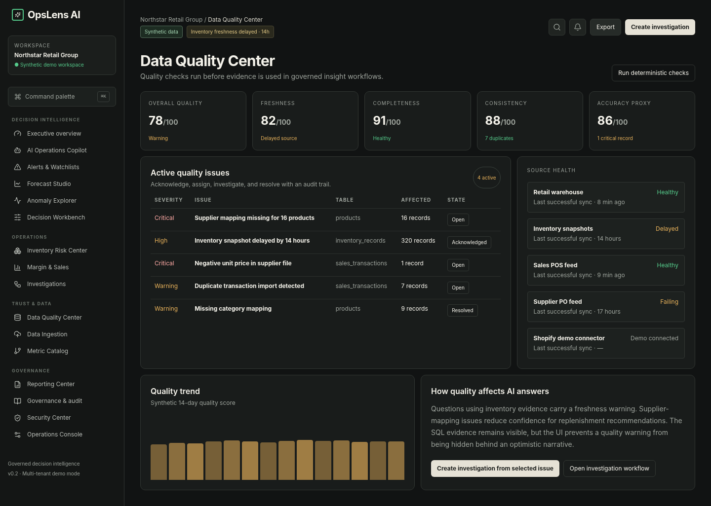 |
| Decision Workbench | 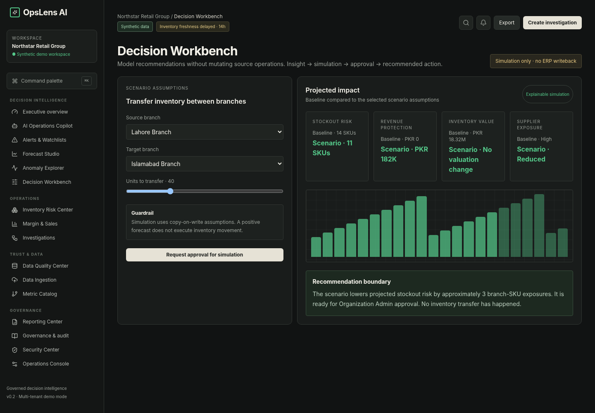 |
| Investigation and approval | 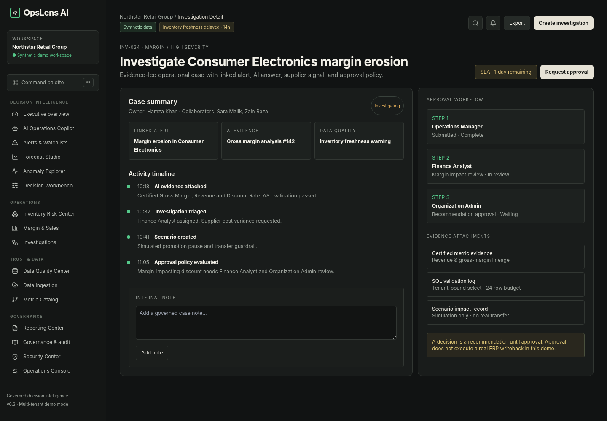 |
| Ingestion | 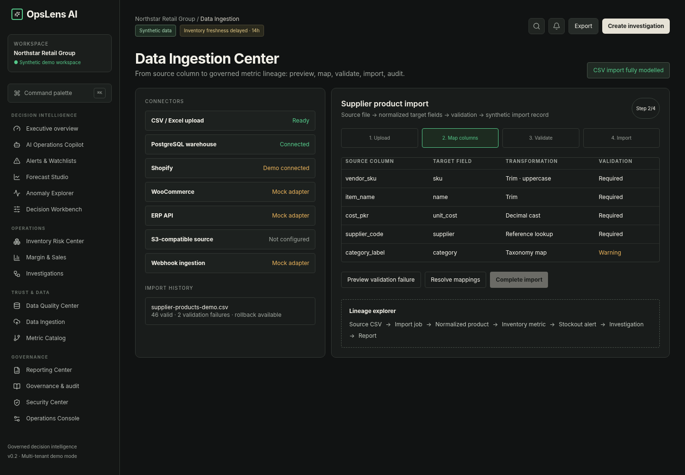 |
| Reporting | 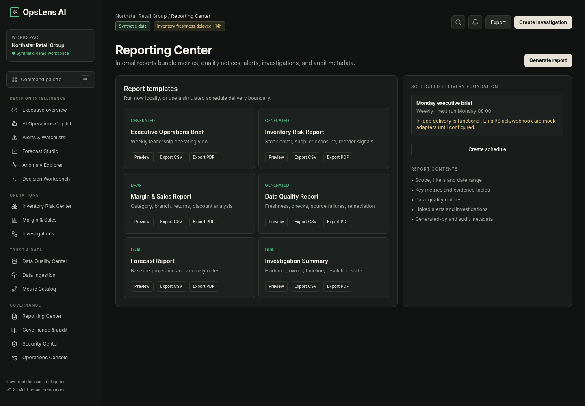 |
| Security | 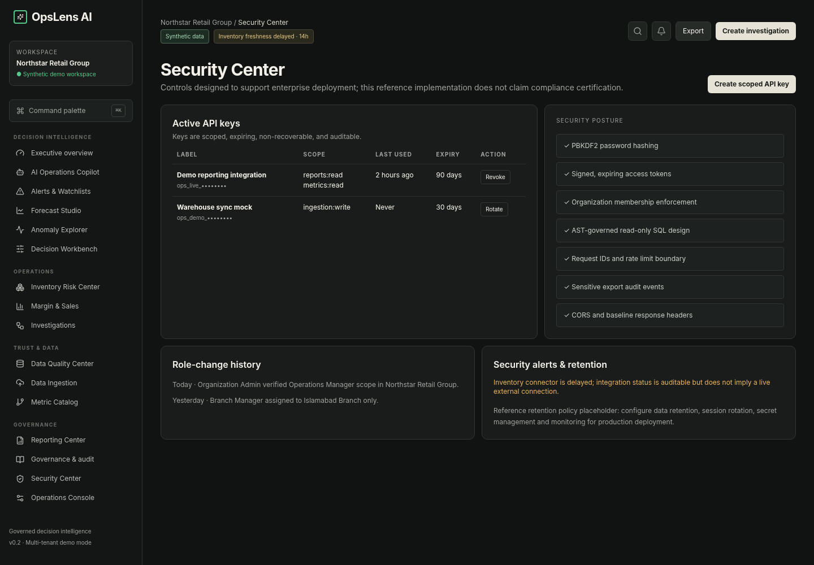 |

## Demo accounts

All accounts use password `DemoPass123!`.

| Email | Role |
|---|---|
| `admin@opslens.demo` | Organization Admin |
| `finance@opslens.demo` | Finance Analyst |
| `ops@opslens.demo` | Operations Manager |
| `supply@opslens.demo` | Supply Chain Manager |
| `branch.manager@opslens.demo` | Branch Manager |
| `viewer@opslens.demo` | Viewer |

## Local deterministic mode

The demo works without external LLM keys, ERP credentials, ecommerce credentials, Slack/email credentials, S3 credentials, webhooks, or supplier APIs. Deterministic local services power Copilot answers, SQL plans, forecast baselines, anomaly records, alert evaluation, scenario impact estimates, report records, and import validation.

## Real local governed-runtime evidence

The accepted animation executes the real FastAPI workflow and stores the actual query plan, SQL validation, evidence rows, forecast, simulated scenario, and approval state:

```powershell
py -3.12 scripts/generate_real_runtime_video.py
```

Review [`docs/animation/REAL_RUNTIME.md`](docs/animation/REAL_RUNTIME.md) and [`docs/animation/runtime-evidence/`](docs/animation/runtime-evidence/). This repository currently has no learned model or external LLM path; that limitation is shown in the report and animation.

## Governed decision animation reference

Regenerate the deterministic synthetic-data reel by running the real FastAPI workflow against a temporary SQLite workspace:

```bash
python scripts/generate_opslens_animation.py
# or: make animation
```

The output is `docs/animation/opslens_decision_sequence.json` plus the dependency-free `apps/web/public/animation/opslens-decision-reel.html`. It remains the reference UI contract; use the real-runtime command above for preserved execution evidence.

## Technology stack

| Layer | Technology |
|---|---|
| Frontend | Next.js 15, React 19, TypeScript, Tailwind CSS |
| Backend | FastAPI, SQLAlchemy, Alembic, Pydantic |
| Governance | SQLGlot-based SQL validation with conservative fallback behavior |
| Auth and security | JWT access tokens, PBKDF2 password hashing, scoped API keys |
| Demo data | Deterministic seeded SQLite workspace, optional PostgreSQL path |
| Tooling | Pytest, Ruff, Mypy, ESLint, Playwright, Docker Compose |

## Architecture

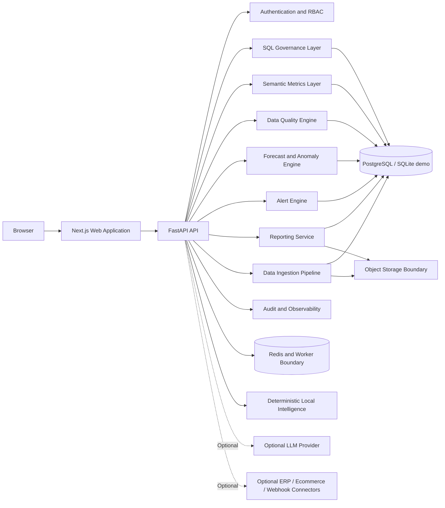

## Governed AI query lifecycle

```mermaid
flowchart LR
    Question[User Question]
    Scope[Workspace and RBAC Scope]
    Plan[Structured Query Plan]
    Metrics[Metric and Table Selection]
    SQL[SQL Generation]
    AST[AST Validation]
    Tenant[Tenant and Branch Predicate Enforcement]
    Execution[Read-Only Query Execution]
    Evidence[Evidence Packaging]
    Quality[Data Quality Notices]
    Answer[Grounded Answer]
    Audit[Audit Event]

    Question --> Scope --> Plan --> Metrics --> SQL --> AST --> Tenant --> Execution --> Evidence --> Quality --> Answer --> Audit
```

## SQL governance decision flow

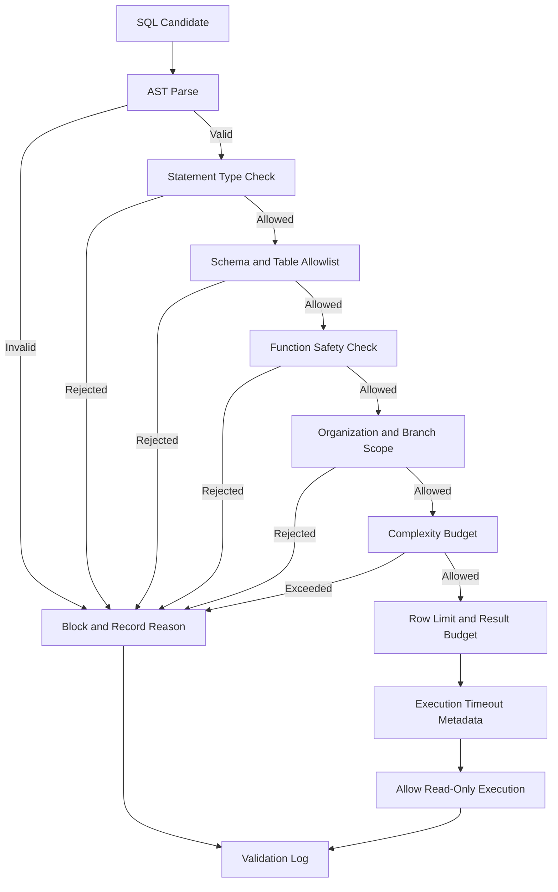

## Data ingestion lifecycle

```mermaid
flowchart LR
    File[CSV / XLSX / JSON]
    Metadata[Metadata and Checksum]
    Preview[Schema Preview]
    Mapping[Column Mapping]
    Validation[Row-Level Validation]
    DryRun[Dry Run]
    Commit[Simulated Commit]
    Quality[Data Quality Checks]
    Metrics[Metric Update]
    Lineage[Lineage Graph]
    Audit[Audit Event]

    File --> Metadata --> Preview --> Mapping --> Validation --> DryRun --> Commit --> Quality --> Metrics --> Lineage --> Audit
```

## Data lineage workflow

```mermaid
flowchart LR
    Source[Data Source]
    Import[Import Job]
    Raw[Source Record]
    Normalized[Normalized Record]
    Metric[Metric]
    Alert[Alert]
    AI[AI Answer]
    Investigation[Investigation]
    Scenario[Scenario]
    Approval[Approval]
    Report[Report]
    Audit[Audit Event]

    Source --> Import --> Raw --> Normalized --> Metric --> Alert --> AI --> Investigation --> Scenario --> Approval --> Report --> Audit
```

## Alert and investigation workflow

```mermaid
flowchart LR
    Signal[Metric or Quality Signal]
    Rule[Alert Rule]
    Alert[Alert Instance]
    Triage[Acknowledge / Assign]
    Investigation[Investigation]
    Evidence[Evidence Review]
    Scenario[Scenario]
    Approval[Approval]
    Resolution[Resolution]
    Report[Report]
    Audit[Audit Event]

    Signal --> Rule --> Alert --> Triage --> Investigation --> Evidence --> Scenario --> Approval --> Resolution --> Report --> Audit
```

## Forecast, anomaly, and scenario workflow

```mermaid
flowchart LR
    Historical[Historical Data]
    Forecast[Baseline Forecast]
    Anomaly[Anomaly Detection]
    Risk[Risk Alert]
    Scenario[Scenario Builder]
    Impact[Impact Analysis]
    Approval[Approval]
    Simulated[Simulated Execution]
    Report[Follow-Up Report]

    Historical --> Forecast --> Anomaly --> Risk --> Scenario --> Impact --> Approval --> Simulated --> Report
```

## Multi-tenant authorization flow

```mermaid
flowchart LR
    Request[Request]
    Auth[Authentication]
    Workspace[Workspace Resolution]
    Membership[Membership Check]
    Role[Role Check]
    Branch[Branch Scope Check]
    Query[Tenant-Scoped Query]
    Response[Response]
    Audit[Audit Event]

    Request --> Auth --> Workspace --> Membership --> Role --> Branch --> Query --> Response --> Audit
```

## Reporting workflow

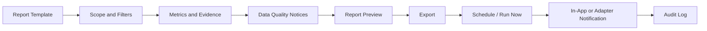

## Deployment topology

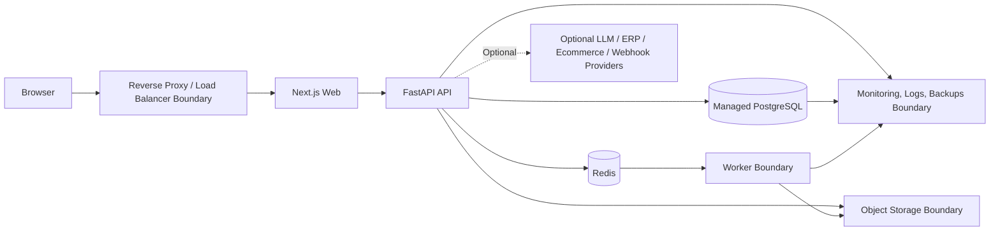

## CI/CD quality gate

```mermaid
flowchart LR
    Push[Push or Pull Request]
    Lint[Lint]
    Types[Type Check]
    Unit[Unit Tests]
    Integration[Integration Tests]
    Migration[Migration Check]
    Seed[Seed Check]
    Build[Frontend Build]
    Browser[Browser Tests]
    A11y[Accessibility Checks]
    Artifact[Artifact / Release]

    Push --> Lint --> Types --> Unit --> Integration --> Migration --> Seed --> Build --> Browser --> A11y --> Artifact
```

## Local setup

Prerequisites:

- Python 3.12
- Node.js 22 and npm
- Optional: Docker Desktop for the compose workflow
- Optional: Playwright browser binaries for end-to-end browser tests

Environment:

```bash
cp .env.example .env
```

Backend:

```bash
cd apps/api
python -m venv .venv
source .venv/bin/activate
pip install -e '.[dev]'
alembic upgrade head
python -m app.seed --reset
uvicorn app.main:app --reload --port 8000
```

Frontend:

```bash
cd apps/web
npm ci
NEXT_PUBLIC_API_BASE_URL=http://localhost:8000 npm run dev
```

Docker reference stack:

```bash
docker compose up --build
```

## Useful commands

```bash
make test
make lint
make typecheck
make screenshots
```

API smoke path:

```bash
curl -X POST http://localhost:8000/api/v1/auth/login \
  -H 'Content-Type: application/json' \
  -d '{"email":"admin@opslens.demo","password":"DemoPass123!"}'
```

Python SDK example:

```python
from opslens.client import OpsLensClient

client = OpsLensClient(
    base_url="http://localhost:8000",
    email="admin@opslens.demo",
    password="DemoPass123!",
)

overview = client.get("/api/v1/dashboard/overview")
print(overview["kpis"][0])
```

Useful local examples:

- `python examples/ask_copilot.py`
- `python examples/create_investigation.py`
- `python examples/create_scenario.py`
- `python examples/generate_report.py`
- `python examples/import_csv.py`
- `python examples/list_alerts.py`
- `python examples/webhook_receiver.py`

## Environment variables

The project ships with `.env.example` and does not require real external credentials for the default deterministic demo path.

| Variable | Purpose |
|---|---|
| `ENVIRONMENT` | Startup mode such as `development` or `production` |
| `DEMO_MODE` | Enables deterministic synthetic workflows |
| `DATABASE_URL` | SQLite for local demo, PostgreSQL for deployment |
| `JWT_SECRET` | Signing key for access and refresh tokens |
| `CORS_ORIGINS` | Allowed browser origins |
| `REQUEST_RATE_LIMIT` | Simple per-minute request cap |
| `SQL_ROW_LIMIT` | Max rows returned by governed SQL |
| `SQL_TIMEOUT_MS` | SQL execution budget metadata |
| `SQL_COMPLEXITY_LIMIT` | Complexity ceiling for generated SQL |
| `NEXT_PUBLIC_API_BASE_URL` | Browser-facing API base URL |

## Additional documentation

- `docs/architecture.md`
- `docs/api-guide.md`
- `docs/demo-guide.md`
- `docs/deployment.md`
- `docs/security.md`
- `docs/testing.md`
- `docs/verification.md`

## Repository structure

```text
apps/api/                 FastAPI app, models, services, SQL guard, migrations, tests
apps/web/                 Next.js app, command-center UI, API client, live workflow panels
assets/screenshots/       Portfolio screenshot set
packages/python_sdk/      Lightweight SDK-style client
examples/                 API examples and mock webhook receiver
docs/                     Architecture, governance, security, testing, deployment docs
.github/workflows/        CI quality gate
```

## Security posture

Security controls are designed to support enterprise deployment. The demo includes PBKDF2 password hashing, signed expiring tokens, organization membership checks, branch-aware restrictions, scoped API keys, API-key revocation, rate limiting, request IDs, security headers, startup production validation, and audit events. Formal compliance certification is not claimed.

## Optional provider boundaries

| Boundary | Status |
|---|---|
| Deterministic local Copilot | Fully working local demo |
| External LLM provider | Optional adapter boundary, not required |
| Shopify / WooCommerce / ERP | Mock connector architecture only |
| Email / Slack / webhook delivery | Simulated/local adapter boundary |
| Object storage | Architecture boundary for reports/imports |

## Verification summary

The latest verification is recorded in `docs/verification.md`. In this launch pass, backend tests, lint, and typing checks passed locally. The frontend lockfile was cleaned to remove environment-specific internal registry URLs, but `npm ci` could not be completed in this environment because package extraction stalled after switching to public npm tarballs, so frontend lint, typecheck, build, and browser tests are not claimed as passed in this verification run. Docker was not available here.

## Honest limitations

- Forecasting is a transparent baseline estimate, not a production accuracy claim.
- Scenario execution is simulated and never writes back to ERP, ecommerce, or inventory systems.
- External delivery providers are stubs/mocks unless configured by a future deployment.
- PostgreSQL row-level security and dedicated read-only AI roles are documented production recommendations; do not claim them enabled unless configured and tested in deployment.
- Some high-density visual panels retain synthetic presentation data while Phase 3 live API panels expose real backend state and mutations for the workflow.

## Production deployment checklist

- Managed PostgreSQL with backups and migration approval process.
- Redis for worker queues and scheduled jobs.
- Object storage for exports, import error files, and evidence bundles.
- Secrets manager for JWT, database, provider, and webhook secrets.
- Reverse proxy / load balancer with TLS.
- Trusted origins and strict CORS.
- Dedicated read-only AI database role, statement timeout, lock timeout, and query logging.
- Centralized logs, metrics, traces, and error tracking.
- API rate limits and abuse monitoring.
- Data retention policy and access reviews.
- Incident response procedure.
- External LLM / ERP / ecommerce credentials only after security review.

## Roadmap

- Production RLS policy tests.
- Real warehouse ingestion adapters.
- Background workers for alert/report schedules.
- Real notification provider integration.
- Stronger frontend unit coverage.
- Deployment templates for managed cloud infrastructure.

## Contributing

Keep the deterministic demo safe and runnable without external keys. New AI or SQL features must preserve tenant scoping, read-only execution, evidence packaging, quality notices, audit logging, and honest capability boundaries.

For contribution workflow details, issue templates, and pull request expectations, see [CONTRIBUTING.md](CONTRIBUTING.md).

## License

This project is released under the [MIT License](LICENSE).
