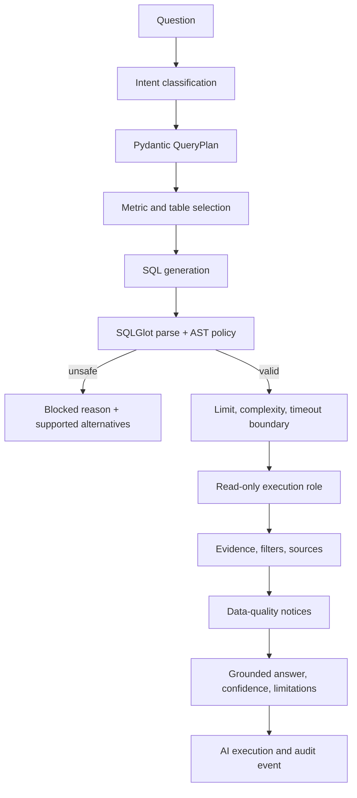

# AI Governance

OpsLens AI applies a governed decision path to deterministic answers and any future provider-backed answer. It intentionally separates language understanding from authorization, SQL safety, data access, evidence packaging, and business action.

## Query plan

A plan records question, organization ID, intent, selected metrics, allowed tables, dimensions, filters, date range, aggregation, ranking, row limit, follow-up requirement, confidence, and explanation strategy. Deterministic fallbacks create the same plan shape; they do not bypass governance.

## SQL policy

`app/sql_guard.py` uses SQLGlot to parse PostgreSQL syntax, reject invalid or multi-statement input, reject DDL/DML/transaction controls, validate allowlisted schemas/tables, block known risky functions, enforce a row cap, score complexity, and require a tenant bind parameter where scoped query templates apply.

The guard is a service-layer control. Production deployment should additionally use a dedicated read-only database role, server-side statement timeout, network restrictions, prepared bind parameters, and a narrow reporting schema.

## Unsupported questions

Unsupported questions are refused with a reason and safe alternatives. The system never fabricates external data such as customer sentiment when review/support data is not connected.

## Approval policy boundary

Recommendations can enter a multi-step policy. The reference policies require role-specific decisions such as `Operations Manager → Organization Admin` for inventory-transfer simulations and `Finance Analyst → Organization Admin` for margin-impacting simulations. Each transition, rejection, expiry, and final simulated result is written as an approval event. Approval never performs an ERP writeback in this reference implementation.
