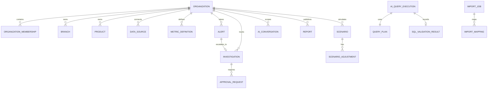

# Data Model

The Phase 2 model is centered around organization-owned operational data and traceable decision artifacts.

## Core domains

- **Retail data:** branches, regions, suppliers, categories, products, inventory, sales, returns, POs, PO lines, and stock movements.
- **Trust data:** sources, metric definitions, quality issues, validation results, audit events, API keys, and webhook delivery logs.
- **Decision data:** alerts/rules/watchlists, forecasts/anomalies, AI conversations/executions/plans, scenarios, reports/schedules, investigations/approvals.

Every organization-facing record includes or is reached through an organization scope. The service API uses that scope in its lookup and query clauses.
